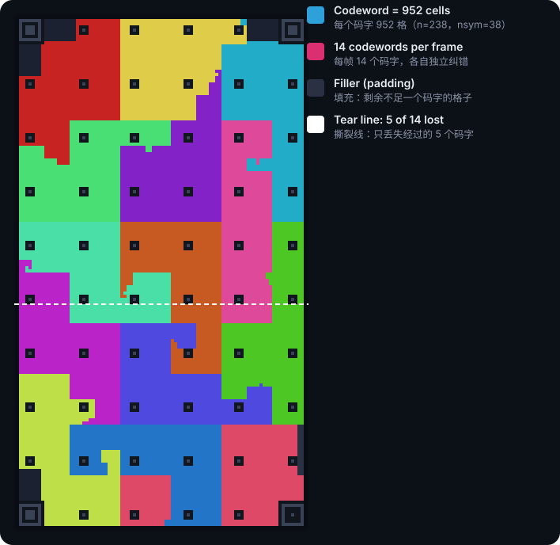

# 1 · 工作原理

[指南目录](README.zh-CN.md) · [English](01-how-it-works.md) · 规范对应章节：§3–§9

## 1.1 全景

```
发送端                                                          接收端
文件 ─► 压缩 ─► 源块 ─► 喷泉码 ─► 数据包 ─► RS 码字 ─► 帧      相机照片 ─► 定位网格 ─► 读格子颜色
                                                     │            ▲                          │
                                                     ▼            │                          ▼
                                                    屏幕 ─────── 光 ───                  RS 译码 ─► 数据包
                                                                                             │
                                                                     文件 ◄─ 解压 ◄─ 喷泉解码 ◄┘
```

整条链路是**单向**的：接收端从不告诉发送端"我缺什么"。所以协议的每一层都按"信道会丢东西、而且不能重传"来设计。

## 1.2 一帧长什么样


*图：一个 48×84 的竖向小网格（真实帧通常 80×140 到 150×260）。图由 `src/tools/figures.js` 用参考实现生成，与规范一致。*

| 部件 | 数量与大小 | 作用 |
|---|---|---|
| 定位图案（finder） | 3 个，7×7 | 纸-墨-纸-墨-纸，比例 1:1:3:1:1。无论旋转、缩放、透视，横竖斜扫过去比例都不变，很容易在照片里找到 |
| 角标（corner） | 1 个，7×7，右下 | 比例 1:2:1:2:1，和定位图案不同，所以接收端能分清四个角，知道方向，也知道是不是镜像 |
| 分隔带 | 每个图案内侧一条墨色带 | 把图案和数据格子隔开，避免数据颜色干扰图案识别 |
| 帧头 | 4 份，每份 70 格 | 网格尺寸、颜色模式、码字长度、纠错字节数、帧序号、CRC。4 份分布在三个角附近，挡住一两个也能读 |
| 校准点 | 3×3 的小点，成点阵 | 让接收端逐步跟踪透视和镜头畸变，而不是只靠四个角估计整幅网格 |
| 数据格子 | 其余所有格子（真实帧中占 93–95%） | 每格 1、2 或 3 比特，承载码字 |

为什么帧头有 4 份、而且每份的掩码不同？因为帧头是**唯一没有纠错的部分**（只有 CRC）：它决定了怎么解释其余所有格子，读错一位就整帧作废。4 份副本让它在一个角反光、一个角失焦时仍然可读；不同的掩码则防止接收端把镜像图像中的"副本 B"误当成"副本 A"（B 正好是 A 的转置）。读单份都失败时，接收端还会把几份的"软值"相加做多数表决（指南 2）。

### 颜色

| 模式 | 每格比特 | 颜色 |
|---|---|---|
| C2 | 1 | 墨、纸 |
| C4（默认） | 2 | 墨、青、品红、黄 |
| C8 | 3 | 8 色，三个比特分别对应 R、G、B 通道 |

C8 的设计细节：颜色索引的三个比特就是 (R, G, B) 三个通道的"开/关"。相机把某个通道判断错，只错一个比特，而不是随机错三个。即便如此，C8 对对焦和摩尔纹更敏感，所以默认是 C4。

## 1.3 从文件到格子

**① 压缩。** 如果 DEFLATE 能把文件压小 3% 以上，就压缩。文本、JSON 通常能压到 1/3 到 1/5，这是"免费"的提速。

**② 切成源符号和源块。** 载荷按 T 字节一块切开（T 通常 190–210 字节），称为源符号。每 16384 个符号组成一个源块，各块独立编码。

**③ 喷泉码。** 这是整个协议提速的核心之一。对一个有 K 个源符号的源块，编码器可以生成**无限多个**编码符号，编号（ESI）从 0 往上。每个编码符号是若干源符号（以及少量预编码的冗余符号）的异或。神奇之处在于：

> 接收端收到**任意** K + 2 个左右**不同**的编码符号，就能解出全部 K 个源符号。

（实测：平均约需 K + 1.6 个符号，最小的源块更少，最大的源块约需 K + 2.4 个；每多一个符号，解码仍然失败的概率大约减半。完整的表格见规范附录 C.2。）

所以接收端不关心收到的是哪些符号、丢了哪些帧、从什么时候开始扫。发送端也不需要"循环播放"：每一帧都是新数据。Lumen Code 的喷泉码与 RaptorQ 同属一类（LT 码 + LDPC/HDPC 预编码，解码用"失活"高斯消元），参数和伪随机数生成器都在规范 §9 中完全确定，两个实现生成的符号逐位相同。

**④ 数据包。** 每个编码符号加一个 7 字节的包头/包尾：

```
[传输 ID 2B][M|源块号 1B][ESI 2B][符号 T 字节][CRC-16 2B]
```

- 传输 ID 区分不同的文件；接收端用（传输 ID, T）识别一次传输。
- M = 1 的包是**元数据包**，装着文件描述符（文件名、大小、CRC-32、是否压缩）。它每 4 帧出现一次（小文件每帧都有），所以接收端中途加入也能拿到文件名。它每次换一个码字位置，所以屏幕某个角上的反光不会遮住它的所有副本。
- CRC-16 用来拦截 RS 译码偶尔"纠正"成错误值的码字，保护喷泉解码器不被污染。

**⑤ Reed–Solomon 码字。** 每个数据包作为消息，加上 nsym 个校验字节，变成长度 n 的 RS 码字（n 通常 235–255，默认纠错等级下 nsym ≈ 16% · n）。RS 能纠正 nsym/2 个错误字节；如果接收端知道哪些字节可疑（擦除），能纠正更多。

**⑥ 排进网格。** 码字按比特依次填进数据格子，次序是一条 **Hilbert 曲线**，并与一个固定的伪随机序列异或（加扰）。



*图：90×160 竖向网格、C4，14 个码字。每种颜色是一个码字占用的格子。*

为什么用 Hilbert 曲线？它让每个码字占据一块**紧凑**的区域，而不是一整行或散落各处。相机经常会拍到"撕裂帧"（卷帘快门扫到一半时屏幕换了帧），上半部分是旧帧、下半部分是新帧。图中的虚线是一条撕裂线：只有它穿过的 5 个码字会坏，其余 9 个照样能用。反光、局部失焦也一样，只影响那一块的码字。

为什么要加扰？让每一帧的颜色分布都接近均匀，没有大片同色区域。这让接收端的颜色聚类（k-means）始终有充足的样本，也避免大片单色带来的曝光波动。

**⑦ 帧头与固定图案。** 最后画上定位图案、角标、校准点和 4 份带当前帧序号的帧头，一帧就完成了。

## 1.4 从格子到文件

接收端反过来做：

1. 在照片里找到定位图案和角标，测量格子大小，读帧头；
2. 沿校准点阵建立"格子坐标 → 照片像素"的映射；
3. 采样每个数据格子的颜色，归一化、分类成调色板索引；
4. 把比特还原成码字，逐个做 RS 译码，只留下 CRC 正确的数据包；
5. 数据包按（传输 ID, T）归入传输，按源块交给喷泉解码器；
6. 每个源块收到足够的符号就解码；全部解出后解压，核对大小和 CRC-32。

第 1–3 步是最难的部分，[指南 2](02-scanner.zh-CN.md) 专门讲。

## 1.5 一个具体的例子

手机屏幕上的竖向码，83×147 格，C4，默认纠错：

| 量 | 值 | 来历 |
|---|---|---|
| 数据格子 | 11 296（92.6%） | 其余是图案、帧头、校准点 |
| 码字 | n = 235，nsym = 38，每帧 12 个 | §7.2、§10.3 |
| 每个符号 | T = 190 字节 | 235 − 38 − 7 |
| 每帧载荷 | 2 280 字节 | 12 × 190 |
| 每秒（12 帧） | 约 27 KB | 理论值，假设每帧都收到 |

传一个 100 KB 的文件（假设不可压缩）：需要约 539 个源符号，约 46 帧，12 帧/秒下约 3.8 秒。如果接收端漏掉 25% 的帧，需要约 61 帧、约 5.1 秒：**丢帧只按比例增加时间**，不会出现"就差一帧、再等一整轮"的情况。

笔记本屏幕上的码通常是 143×254 格：每帧 34 个码字、约 6.9 KB，12 帧/秒约 82 KB/s；C8 时约 10.3 KB/帧、约 124 KB/s。

## 1.6 接下来

- 想知道每个数字在演示页面上怎么看：[指南 5 · 仪表解读](05-dashboard.zh-CN.md)
- 想知道比动态二维码快在哪里、还能怎么更快：[指南 4 · 性能](04-performance.zh-CN.md)
- 想直接用：[指南 3 · 接入](03-integration.zh-CN.md)
