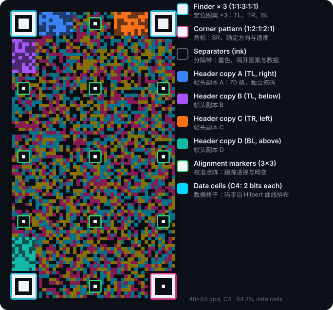

# 1 · How it works

[Guide index](README.md) · [中文](01-how-it-works.zh-CN.md) · Specification sections: §3–§9

## 1.1 The big picture

```
Sender
  file ─► compress ─► source blocks ─► fountain code ─► packets ─► RS codewords ─► frame
                                                                                     │
                                                                                     ▼
                                                                                  screen
                                                                                     │
                                                                                   light
                                                                                     │
Receiver                                                                             ▼
  read cell colours ◄─ locate grid ◄────────────────────────────────────────── camera photo
          │
          ▼
      RS decode ─► packets ─► fountain decode ─► decompress ─► file
```

The link is **one-way**: the receiver cannot tell the sender what it is missing. Every layer of the protocol therefore assumes that the channel loses data and cannot retransmit.

## 1.2 What a frame looks like



*Figure: a small 48×84 portrait grid (real frames are usually 80×140 to 150×260). The figure is generated by `src/tools/figures.js` with the reference implementation and matches the specification.*

| Part | Count and size | Purpose |
|---|---|---|
| Finder pattern | 3, 7×7 | Paper-ink-paper-ink-paper, ratio 1:1:3:1:1. A horizontal, vertical or diagonal scan sees this ratio at any rotation, scale or perspective, so the patterns are easy to find in a photo |
| Corner pattern | 1, 7×7, bottom right | Ratio 1:2:1:2:1, unlike the finder patterns, so the receiver can tell the four corners apart and knows the orientation and whether the image is mirrored |
| Separator | One ink band on the inner side of each pattern | Separates the patterns from the data cells so that data colours do not disturb pattern detection |
| Header | 4 copies, 70 cells each | Grid size, colour mode, codeword length, number of ECC bytes, frame sequence number, CRC. The copies sit near three corners, so the header can still be read with one or two of them blocked |
| Alignment marker | Small 3×3 dots, in a lattice | Let the receiver track perspective and lens distortion piece by piece instead of estimating the whole grid from the four corners |
| Data cell | All remaining cells (about 92–96% of a typical frame) | 1, 2 or 3 bits per cell; carry the codewords |

Why 4 header copies, each with a different mask? The header is **the only part without ECC** (it has only a CRC), and it determines how every other cell is interpreted, so one wrong bit voids the whole frame. With 4 copies it stays readable when one corner has glare and another is out of focus. The different masks stop the receiver from mistaking copy B in a mirrored image for copy A (B is exactly the transpose of A). When no single copy can be read, the receiver adds up the soft values of the copies and takes a majority vote (guide 2).

### Colours

| Mode | Bits per cell | Colours |
|---|---|---|
| C2 | 1 | ink, paper |
| C4 (default) | 2 | ink, cyan, magenta, yellow |
| C8 | 3 | 8 colours; the three bits map to the R, G and B channels |

In C8 the three bits of the colour index are the on/off states of the (R, G, B) channels, so if the camera misjudges one channel, only one bit is wrong rather than three random bits. C8 is still more sensitive to focus and moiré, so the default is C4.

## 1.3 From file to cells

**① Compression.** The file is compressed with DEFLATE if that makes it more than 3% smaller. Text and JSON usually shrink to between 1/3 and 1/5 of their size.

**② Split into source symbols and source blocks.** The payload is cut into source symbols of T bytes (T is usually 190–210 bytes). Every 16384 symbols form a source block, and each block is encoded independently.

**③ Fountain code.** This is one of the main reasons the protocol is fast. For a source block with K source symbols, the encoder can generate an **unlimited number** of encoding symbols, numbered (ESI) from 0 upward. Each encoding symbol is the XOR of several source symbols (and a few precoded redundant symbols). The property that matters:

> When the receiver has **any** K + 2 or so **distinct** encoding symbols, it can decode all K source symbols.

(Measured: on average about K + 1.6 symbols, fewer for the smallest blocks and K + 2.4 for the largest; each extra symbol roughly halves the chance that the decode still fails. Specification Appendix C.2 has the full table.)

So the receiver does not care which symbols it gets, which frames it loses or when it starts scanning, and the sender does not need to play in a loop: every frame carries new data. The Lumen Code fountain code is in the same family as RaptorQ (an LT code with LDPC/HDPC precoding, decoded with "inactivation" Gaussian elimination). Its parameters and its pseudo-random number generator are fully defined in specification §9, and the two implementations generate bit-identical symbols.

**④ Packets.** Each encoding symbol gets a 7-byte packet header/trailer:

```
[transfer ID 2B][M|source block number 1B][ESI 2B][symbol, T bytes][CRC-16 2B]
```

- The transfer ID (TID) distinguishes files. The receiver identifies a transfer by (TID, T).
- A packet with M = 1 is a **metadata packet** holding the file descriptor (file name, size, CRC-32, compressed or not). It appears every 4 frames (in every frame for small files), so a receiver that joins midway still gets the file name, and it moves to a different codeword each time, so glare on one corner of the screen cannot hide every copy.
- The CRC-16 catches the occasional codeword that RS decoding "corrects" to a wrong value, so that it does not pollute the fountain decoder.

**⑤ Reed–Solomon codewords.** Each packet, with nsym check bytes added, becomes an RS codeword of length n (n is usually 235–255; at the default ECC level nsym ≈ 16% · n). RS can correct nsym/2 wrong bytes, and more if the receiver knows which bytes are suspect (erasures).

**⑥ Placement in the grid.** The codewords fill the data cells bit by bit, in the order of a **Hilbert curve**, and are XORed with a fixed pseudo-random sequence (whitening).


*Figure: a 90×160 portrait grid, C4, 14 codewords. Each colour marks the cells of one codeword.*

Why a Hilbert curve? It gives each codeword a **compact** area instead of a whole row or scattered cells. Cameras often capture torn frames: the screen changes frames partway through the rolling-shutter scan, so the top of the photo shows the old frame and the bottom the new one. The dashed line in the figure is a tear line; only the 5 codewords it crosses are damaged, and the other 9 are still usable. Glare and local defocus likewise affect only the codewords in their area.

Why whitening? It keeps the colour distribution of every frame close to uniform, with no large single-colour areas, so the receiver's colour clustering (k-means) always has enough samples and the camera exposure does not swing as it would over large areas of one colour.

**⑦ Header and fixed patterns.** Finally the finder patterns, the corner pattern, the alignment markers and the 4 header copies (with the current frame sequence number) are drawn.

## 1.4 From cells to file

The receiver works in reverse:

1. Find the finder patterns and the corner pattern in the photo, measure the cell size, and read the header.
2. Follow the alignment marker lattice to build a "cell coordinates → photo pixels" mapping.
3. Sample the colour of each data cell, normalise it, and classify it into a palette index.
4. Turn the bits back into codewords, RS-decode them one by one, and keep only the packets with a correct CRC.
5. Assign packets to transfers by (TID, T), and pass them to the fountain decoder per source block.
6. Decode each source block once it has enough symbols. When all blocks are decoded, decompress, then check the size and the CRC-32.

Steps 1–3 are the hardest; [Guide 2](02-scanner.md) covers them in detail.

## 1.5 A concrete example

A portrait code on a phone screen, 83×147 cells, C4, default ECC:

| Quantity | Value | Derivation |
|---|---|---|
| Data cells | 11 296 (92.6%) | The rest are patterns, header and alignment markers |
| Codewords | n = 235, nsym = 38, 12 per frame | §7.2, §10.3 |
| Each symbol | T = 190 bytes | 235 − 38 − 7 |
| Payload per frame | 2 280 bytes | 12 × 190 |
| Per second (12 frames) | about 27 KB | Theoretical, assuming every frame is received |

A 100 KB file (assumed incompressible) is about 539 source symbols, which takes about 46 frames, or about 3.8 seconds at 12 FPS. If the receiver misses 25% of the frames, it needs about 61 frames, about 5.1 seconds. Dropped frames add time only in proportion; the receiver never has to wait a whole pass for one missing frame.

A code on a laptop screen is usually 143×254 cells: 34 codewords per frame, about 6.9 KB, and about 82 KB/s at 12 FPS. With C8 it is about 10.3 KB per frame and about 124 KB/s.

## 1.6 What next

- How to read each number on the demo pages: [Guide 5 · Reading the dashboard](05-dashboard.md)
- Where it is faster than animated QR codes, and how to make it faster: [Guide 4 · Performance](04-performance.md)
- Use it right away: [Guide 3 · Integration](03-integration.md)
